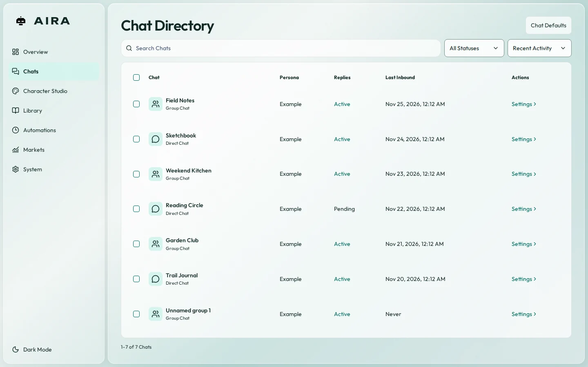
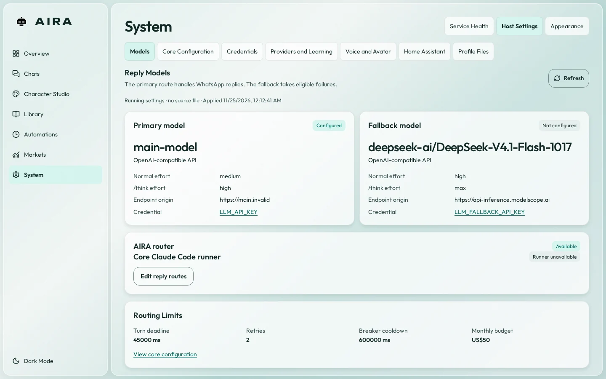
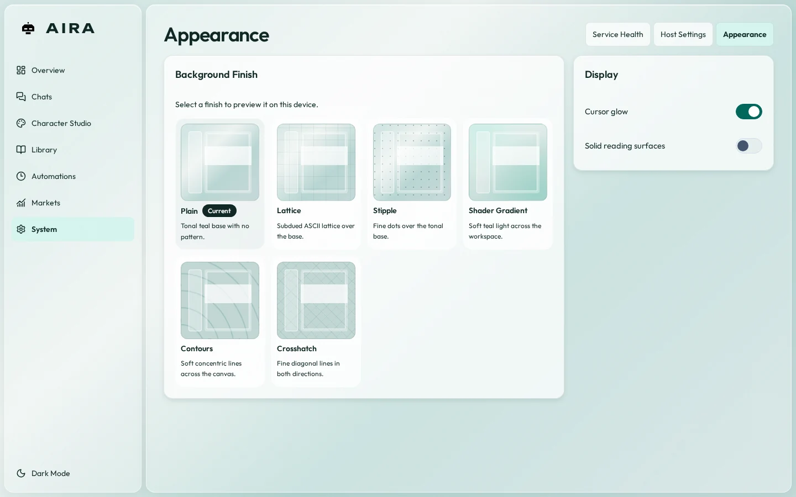
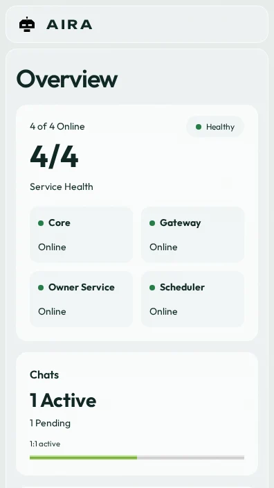

<a id="readme-top"></a>

<!-- PROJECT BANNER -->

<br />
<div align="center">
  <a href="https://github.com/TolongLabs/AIRA">
    <picture>
      <source media="(prefers-color-scheme: dark)" srcset="docs/images/banner-dark.webp" />
      
    </picture>
  </a>

  <h1>AIRA</h1>

  <p>
    AIRA replies to WhatsApp DMs and small groups in the voice of the character assigned to each chat. The owner
    dashboard controls which chats receive replies, which models answer them, and which routines run.
    <br />
    <a href="#quick-setup"><strong>Quick Setup &rarr;</strong></a>
    &middot;
    <a href="#open-the-owner-dashboard">Open The Dashboard</a>
    &middot;
    <a href="#screenshots">Screenshots</a>
    &middot;
    <a href="#documentation">Documentation</a>
    &middot;
    <a href="https://github.com/TolongLabs/AIRA/issues/new/choose">Report A Bug</a>
    <br />
  </p>

[![Release][release-badge]][release-url]
[![CI][ci-badge]][ci-url]
[![Licence][licence-badge]][licence-url]
[![TypeScript][typescript-badge]][typescript-url]
[![Node.js][node-badge]][node-url]
[![Bun][bun-badge]][bun-url]
[![SQLite][sqlite-badge]][sqlite-url]
[![DuckDB][duckdb-badge]][duckdb-url]
[![Zod][zod-badge]][zod-url]
[![React][react-badge]][react-url]
[![Vite][vite-badge]][vite-url]
[![Tailwind CSS][tailwindcss-badge]][tailwindcss-url]
[![Vitest][vitest-badge]][vitest-url]
[![Playwright][playwright-badge]][playwright-url]
[![Docker][docker-badge]][docker-url]

</div>

<!-- TABLE OF CONTENTS -->

## Table Of Contents

<details>
  <summary>Expand</summary>
  <ol>
    <li>
      <a href="#about-the-project">About The Project</a>
      <ul>
        <li><a href="#links">Links</a></li>
        <li><a href="#a-conversation-with-aira">A Conversation With AIRA</a></li>
        <li><a href="#screenshots">Screenshots</a></li>
        <li><a href="#how-a-reply-works">How A Reply Works</a></li>
        <li><a href="#features">Features</a></li>
        <li><a href="#architecture">Architecture</a></li>
        <li><a href="#project-structure">Project Structure</a></li>
        <li><a href="#tech-stack">Tech Stack</a></li>
      </ul>
    </li>
    <li>
      <a href="#getting-started">Getting Started</a>
      <ul>
        <li><a href="#prerequisites">Prerequisites</a></li>
        <li><a href="#quick-setup">Quick Setup</a></li>
        <li><a href="#open-the-owner-dashboard">Open The Owner Dashboard</a></li>
        <li><a href="#run-tests">Run Tests</a></li>
      </ul>
    </li>
    <li><a href="#operations">Operations</a></li>
    <li><a href="#rules-across-modules">Rules Across Modules</a></li>
    <li><a href="#engineering-highlights">Engineering Highlights</a></li>
    <li><a href="#documentation">Documentation</a></li>
    <li><a href="#contributing">Contributing</a></li>
    <li><a href="#maintainers">Maintainers</a></li>
    <li><a href="#ai-disclosure">AI Disclosure</a></li>
    <li><a href="#licence">Licence</a></li>
    <li><a href="#acknowledgements">Acknowledgements</a></li>
  </ol>
</details>

<!-- ABOUT THE PROJECT -->

<a id="about-the-project"></a>

## About The Project

AIRA answers WhatsApp DMs and small groups from **one Linux host on a private network**, behind the Hermes Agent
WhatsApp gateway. Each chat is bound to **one character pack and its own settings**, so two chats can talk to two
different characters at the same time.

The character is held in place by code, not by prompt wording. Code detects the mood, draws the reply shape, cleans the
reply and renders it for WhatsApp. **One agent loop, one tool set and one voice** answer every turn, whichever model
runs it.

Memory is stored as typed records in **one SQLite file**, scoped strictly to the chat it came from. Every turn and every
failure leaves a record, so a fault can be found after the fact and replayed offline without WhatsApp.

<a id="links"></a>

### Links

| Resource               | Link                                                                                              |
| ---------------------- | ------------------------------------------------------------------------------------------------- |
| Product Requirements   | [`docs/PRD.md`](docs/PRD.md), what AIRA must do, for whom, and how far each requirement stands    |
| Technical Requirements | [`docs/TRD.md`](docs/TRD.md), the index of contracts, one module per file in `docs/trd/`          |
| Requirement Status     | [`docs/trd/traceability.md`](docs/trd/traceability.md), code, tests and gap per requirement       |
| Decision Records       | [`docs/decisions/`](docs/decisions/README.md), one record per lasting choice, with its rationale  |
| Runbook                | [`docs/RUNBOOK.md`](docs/RUNBOOK.md), host operations, dashboard checks and recovery              |
| Releases               | [GitHub Releases](https://github.com/TolongLabs/AIRA/releases) and [`CHANGELOG.md`](CHANGELOG.md) |

<p align="right"><a href="#readme-top">&uarr;</a></p>

<a id="a-conversation-with-aira"></a>

### A Conversation With AIRA

A member asks what to make with rice and an egg, then asks how to get crispy edges. These are replies from the
installed AIRA character in the **WhatsApp Simulator**. The simulator used a fresh chat, the real core and its
configured model routes.

<p align="center">
  <picture>
    <source media="(prefers-color-scheme: dark)" srcset="docs/images/whatsapp-dark.webp" />
    
  </picture>
</p>

[Light Conversation](docs/images/whatsapp-light.webp) · [Dark Conversation](docs/images/whatsapp-dark.webp)

<p align="right"><a href="#readme-top">&uarr;</a></p>

<a id="screenshots"></a>

### Screenshots

The dashboard screenshots use fictional chats and isolated settings. Each one follows your GitHub theme.

<p align="center">
  <picture>
    <source media="(prefers-color-scheme: dark)" srcset="docs/images/overview-dark.webp" />
    
  </picture>
</p>

[Light Overview](docs/images/overview-light.webp) · [Dark Overview](docs/images/overview-dark.webp) ·
[Phone Overview](docs/images/overview-phone.webp)

<table>
  <tr>
    <td width="50%" valign="top" align="left">
      <picture>
        <source media="(prefers-color-scheme: dark)" srcset="docs/images/chats-dark.webp" />
        
      </picture>
      <br />
      <strong>Chat Directory</strong> · Find a conversation and open its settings.
    </td>
    <td width="50%" valign="top" align="left">
      <picture>
        <source media="(prefers-color-scheme: dark)" srcset="docs/images/models-dark.webp" />
        
      </picture>
      <br />
      <strong>Reply Models</strong> · Inspect each role and see which Claude Code paths are available.
    </td>
  </tr>
  <tr>
    <td width="50%" valign="top" align="left">
      <picture>
        <source media="(prefers-color-scheme: dark)" srcset="docs/images/studio-editor-dark.webp" />
        
      </picture>
      <br />
      <strong>Character Studio</strong> · Edit a character's identity and speech rules.
    </td>
    <td width="50%" valign="top" align="left">
      <picture>
        <source media="(prefers-color-scheme: dark)" srcset="docs/images/appearance-dark.webp" />
        
      </picture>
      <br />
      <strong>Appearance</strong> · Preview background finishes and adjust reading surfaces.
    </td>
  </tr>
  <tr>
    <td width="50%" valign="top" align="center">
      <picture>
        <source media="(prefers-color-scheme: dark)" srcset="docs/images/chat-confirm-dark.webp" />
        
      </picture>
      <br />
      <strong>Message Review</strong> · Confirm the chat and message before sending as owner.
    </td>
    <td width="50%" valign="top" align="center">
      
      <br />
      <strong>Phone Overview</strong> · The same Overview on a phone.
    </td>
  </tr>
</table>

Character Studio edits identity, speech, moods and fixed lines. Its **Preview Conversation** shows a draft's configured
mood openers. The model-backed simulator in the [quick setup](#quick-setup) runs the full reply pipeline.

<p align="right"><a href="#readme-top">&uarr;</a></p>

<a id="how-a-reply-works"></a>

### How A Reply Works

<p align="center">
  
</p>

1. **Receive.** The Hermes gateway receives a message and passes it to the core. Admission checks the chat and sender.
2. **Resolve.** The core loads the character and resolves chat overrides, group or DM defaults and global settings.
3. **Run.** The turn pipeline builds the prompt, runs permitted tools, formats the reply and records the outcome in
   SQLite.
4. **Return.** The gateway returns the reply to the same chat. An owner-written message uses a separate confirmed
   submission with a stable ID, so the owner can look up its outcome after a disconnect.

[`docs/trd/system.md`](docs/trd/system.md#one-turn) walks one turn step by step and links the module behind each step.

<p align="right"><a href="#readme-top">&uarr;</a></p>

<a id="features"></a>

### Features

| Feature                    | What A Chat Gets                                                                                             |
| -------------------------- | ------------------------------------------------------------------------------------------------------------ |
| **One Character Per Chat** | A character pack with its own identity, speech, moods, error lines and optional stickers                     |
| **Per-Chat Settings**      | A three-level hierarchy: global defaults, then chat type, then the chat instance. The nearest level wins     |
| **Mood And Reply Shape**   | Mood detected by rules at no model cost; opener, ending, faces and length drawn by code for that mood        |
| **WhatsApp Formatting**    | Replies rendered in the markup WhatsApp supports, cleaned by one fixed chain, and split into bubbles         |
| **Tools And Commands**     | One registry for every tool, called by the model or by a `/name` command, each with a timeout and a receipt  |
| **Memory That Holds**      | Typed facts, episodes and media, written through one queue, admitted by a judge model that fails closed      |
| **Media And Social Posts** | Files, links and video from social posts watched by a dedicated media model, under size and time limits      |
| **Research And Documents** | `/research` runs as a background job with a PDF offer, and `/doc` writes a document                          |
| **Model Fallback**         | Two transports behind one runner interface, retries inside a deadline, and a monthly spend cap               |
| **Records And A Harness**  | A record for every turn and failure, plus replay, a memory simulator, a WhatsApp simulator and benchmarks    |
| **Owner Dashboard**        | A private console for chats, models, characters and routines, writing through the same validation as startup |

How far each requirement stands is tracked in [`docs/PRD.md`](docs/PRD.md#functional-requirements), and the gap behind
every partial one is named in [`docs/trd/traceability.md`](docs/trd/traceability.md).

<p align="right"><a href="#readme-top">&uarr;</a></p>

<a id="architecture"></a>

### Architecture

Two processes do the work. **The gateway** receives and sends WhatsApp messages and calls the core as its model. **The
core** owns the turn: it resolves the chat, builds the prompt, runs the loop, cleans the reply and returns it.

| Item         | Value                                                                                   |
| ------------ | --------------------------------------------------------------------------------------- |
| Core         | One TypeScript service on Node 24, in one container                                     |
| Transport    | Hermes Agent gateway and its WhatsApp bridge, on the host, at a pinned version          |
| Attach Point | An OpenAI-compatible HTTP endpoint on `127.0.0.1:9881`                                  |
| Store        | One SQLite file on a mounted data volume, written by the core only                      |
| Model Loop   | Google Agent Development Kit (API runner) or the `claude` program (subscription runner) |
| Judge Model  | A hosted small model for mood, memory admission and memory verification                 |

[`docs/TRD.md`](docs/TRD.md) is the contract: one module per subsystem, with the decisions and the rules that hold
across all of them. The diagrams are indexed in [`docs/diagrams/`](docs/diagrams/README.md).

<p align="right"><a href="#readme-top">&uarr;</a></p>

<a id="project-structure"></a>

### Project Structure

```
AIRA/
├── config.yml           deployment settings, reviewed in git
├── .env.example         names of every secret, no values
├── characters/example/  one fictional character pack; real packs live on the data volume
├── prompts/             harness prompt blocks shared by all characters
├── src/                 the core service
│   ├── gateway/             the OpenAI-compatible endpoint and delivery mapping
│   ├── turn/                turn context, admission, the turn pipeline
│   ├── character/           pack schema, loader, validator
│   ├── prompt/              block assembly, mood detection, reply shape
│   ├── format/              cleaning chain, WhatsApp renderer, bubble splitter
│   ├── tools/               registry, handlers, command parser, MCP client
│   ├── memory/              items, write queue, recall, forget
│   ├── judge/               the small judge model
│   ├── models/              runners, transports, routing, spend
│   ├── media/               file and link intake, media watching
│   ├── social/              social post recognition and readers
│   ├── research/            `/research` background jobs
│   ├── render/              the report renderer
│   ├── feedback/            `/report` links and answer sync
│   ├── records/             turn records, failure records, logger
│   ├── settings/            hierarchy resolver, validation, change log
│   ├── storage/             database, migrations
│   ├── config/              `config.yml` schema and loader
│   ├── migration/           import from the old stores
│   └── api/                 site API for chatbot pages
├── site/                the owner dashboard (React, Vite, Tailwind)
├── tests/               unit, contract, replay, simulator, restart and gate suites
├── bench/               benchmark sets
├── live/                live check sets, run before a release
├── scripts/             migration, replay, benchmark and operator tools
├── deploy/              Dockerfile, compose file, gateway patches, host units
└── docs/                PRD, TRD, runbook, decisions, diagrams, images
```

<p align="right"><a href="#readme-top">&uarr;</a></p>

<a id="tech-stack"></a>

### Tech Stack

| Layer           | Technology                                                           |
| --------------- | -------------------------------------------------------------------- |
| Language        | TypeScript in strict mode, ES modules                                |
| Runtime         | Node 24, with Bun as the package manager and script runner           |
| Model Loop      | `@google/adk` for the API runner, and the Anthropic SDK for Claude   |
| Tool Servers    | Model Context Protocol, through `@modelcontextprotocol/sdk`          |
| Validation      | Zod for every config file, card, tool schema and model reply         |
| Store           | SQLite through `better-sqlite3`                                      |
| Analytics       | DuckDB, for report and benchmark scripts only                        |
| Owner Dashboard | React 19, Vite 7, Tailwind CSS 4, Radix UI                           |
| Tests           | Vitest for the core, Playwright for the built site                   |
| Tooling         | Biome, Prettier, Husky, commitlint, gitleaks, Dependabot             |
| Deployment      | One container image, deployed by a self-hosted GitHub Actions runner |
| Off-Host Backup | An encrypted restic repository, at most 15 minutes old               |

<p align="right"><a href="#readme-top">&uarr;</a></p>

<!-- GETTING STARTED -->

<a id="getting-started"></a>

## Getting Started

Try a DM on your computer before connecting a WhatsApp account.

<a id="prerequisites"></a>

### Prerequisites

- [Node.js](https://nodejs.org/) 24 and [Bun](https://bun.sh/) (version pinned in `package.json`)
- A model API key
- Optional: [Docker](https://www.docker.com/), for an installation that delivers replies to WhatsApp

<a id="quick-setup"></a>

### Quick Setup

1. **Clone And Install.** Clone the repository and install the core dependencies.

   ```sh
   git clone https://github.com/TolongLabs/AIRA.git
   cd AIRA
   bun install --frozen-lockfile
   ```

2. **Add Your Key.** In this fresh checkout, create a private environment file.

   ```sh
   install -m 600 .env.example .env
   ```

   Open `.env` in your editor and set `LLM_API_KEY`. The bundled `config.yml` selects Anthropic for the primary role.
   For an OpenAI-compatible provider, set `llm.main.provider` to `openai-compatible` and set `llm.main.baseUrl`,
   `llm.main.model` and `llm.main.effort` to values your provider supports.

3. **Start The Simulator.** Run it from the repository root. Open the local address it prints, choose the direct chat
   and send a message.

   ```sh
   bun run sim --character example
   ```

   The default address is `http://127.0.0.1:9900`. The public checkout includes the fictional **Example** pack. The
   screenshots above use the private **AIRA** pack from the installed host. To try a pack of your own, place it in a
   dedicated simulator data directory under `characters/<pack-id>/`, then pass
   `--data <directory> --character <pack-id>`.

For an installation that delivers replies to WhatsApp, connect the Hermes gateway and run the core with Docker Compose.
The install guide covers the data volume, private configuration, gateway media mounts and health check.
[Host Installation](docs/trd/deployment.md#install) · [Simulator Options](docs/trd/harness.md#whatsapp-simulator)

> **Never Commit `.env`, A Real Character Pack, Or Real Chat Data.** Only the fictional `example` pack belongs in
> `characters/`.

<a id="open-the-owner-dashboard"></a>

### Open The Owner Dashboard

On a host with AIRA and the Hermes owner service installed, open `http://127.0.0.1:9890/overview`. The published
dashboard port is `AIRA_SITE_PORT` (default `9890`). To find yours, run `docker compose port aira 9890` in the host's
install directory. If it differs, use that port on the host side of the SSH tunnel below. The canonical routes use
`AIRA_DASHBOARD_ENTRY=dashboard`. The entry switch and its rollback are documented in the runbook.
[Dashboard Entry Switch](docs/trd/deployment.md#dashboard-entry-recovery)

1. **Forward The Port.** From a laptop, forward the host's dashboard port. Replace `owner@your-host` with your SSH
   login. Keep the SSH session open while using the dashboard.

   ```sh
   ssh -N -o ExitOnForwardFailure=yes -L 127.0.0.1:9890:127.0.0.1:9890 owner@your-host
   ```

2. **Sign In.** Open `http://127.0.0.1:9890/overview` in the laptop browser. At the sign-in prompt, enter the Hermes
   owner site token from the host's `~/.hermes/brain/.site-token` and select **Save token**.
3. **Check The Models.** Open **System → Host Settings → Models** to inspect the primary and fallback routes.
   **Credentials** lets you set or replace a key. **Apply saved changes** activates edits to the installed
   configuration.

<a id="run-tests"></a>

### Run Tests

A local checkout can run the core contract tests and the browser suite with a temporary database, an owner-service
fixture and a fake gateway.

```sh
bun install --frozen-lockfile
(cd site && bun install --frozen-lockfile)
bun run typecheck
bun run lint
bun run format:check
bun run test
bun run --cwd site build
bunx playwright install --with-deps chromium firefox webkit
bun run test:dashboard
```

Vitest exercises the core, and Playwright drives the built site through the private HTTP listener. The test layers and
each gate's threshold are defined in [`docs/trd/harness.md`](docs/trd/harness.md).

<p align="right"><a href="#readme-top">&uarr;</a></p>

<a id="operations"></a>

## Operations

Keep real packs on the data volume and credentials in the host's protected configuration. The runbook covers the
private listener, snapshots, deployment health and rollback. The [operator runbook](docs/RUNBOOK.md) and
[deployment contract](docs/trd/deployment.md) give the commands.

<p align="right"><a href="#readme-top">&uarr;</a></p>

<a id="rules-across-modules"></a>

## Rules Across Modules

Nine rules hold in every module. A change that breaks one changes [`docs/TRD.md`](docs/TRD.md#rules-across-modules)
first.

| Rule                                         | What It Means                                                                                 |
| -------------------------------------------- | --------------------------------------------------------------------------------------------- |
| **SQLite Is Canonical**                      | SQLite holds transactional runtime state, with one core writer. Authored packs stay as files  |
| **Identity Comes From Code**                 | Chat, sender and character are resolved from the gateway request, never supplied by a model   |
| **A Fact Never Leaves Its Chat**             | Memory, style and behaviour state are keyed by chat instance. The memory simulator tests this |
| **One Loop, One Tool Set, One Voice**        | A fallback changes the model and nothing else                                                 |
| **The Character Pack Is The Persona Source** | Program code holds no character name, trait or phrase                                         |
| **Every State Change Has A Receipt**         | The reply may claim an action only when its receipt, built by code, exists                    |
| **Every Turn Leaves A Record**               | A turn that starts writes a turn record. A failure writes a failure record with the turn id   |
| **Untrusted Text Is Labelled**               | Text from users, pages, media and tools enters the prompt inside labelled blocks              |
| **The System Prompt Has A Size Cap**         | A test enforces a fixed token ceiling for every character pack in the repository              |

<p align="right"><a href="#readme-top">&uarr;</a></p>

<a id="engineering-highlights"></a>

## Engineering Highlights

- **Invariants As Gates.** CI fails on a prompt over its size ceiling, unsupported markup after the renderer, a
  character name in `src/`, a phone number or WhatsApp id in the tree, or a live call from the replay and simulator
  layers.
- **A Memory Simulator With Ground Truth.** It checks isolation between chats, lost writes under concurrency and
  crashes, recall drift, forgetting and recovery, on every change.
- **Restart Safety By Rule.** Every unit of work in flight is a database row with a state, so a restart resumes it or
  fails it. The restart suite proves no lost write, no double reply and no stuck lease.
- **Forgetting That Removes.** A forget names one fact by id, clears every trace of it, and bars pending memory work
  from writing it back.
- **A WhatsApp Simulator.** A fake bridge and a chat preview show a reply's formatting, bubble order and sticker
  without WhatsApp.
- **Measured, Not Asserted.** Latency, cost, restore time and each gate were measured on the live host before cutover.
  The figures are in [`docs/READINESS.md`](docs/READINESS.md).
- **Decisions On Record.** Every lasting choice has its own dated record with its rationale, in
  [`docs/decisions/`](docs/decisions/README.md).

<p align="right"><a href="#readme-top">&uarr;</a></p>

<a id="documentation"></a>

## Documentation

| Question                             | Document                                                                                             |
| ------------------------------------ | ---------------------------------------------------------------------------------------------------- |
| What must it do, and for whom?       | [`docs/PRD.md`](docs/PRD.md)                                                                         |
| How is it built?                     | [`docs/TRD.md`](docs/TRD.md) and its modules, starting at [`docs/trd/system.md`](docs/trd/system.md) |
| How far does each requirement stand? | [`docs/trd/traceability.md`](docs/trd/traceability.md), [`docs/READINESS.md`](docs/READINESS.md)     |
| Why is it built this way?            | [`docs/decisions/`](docs/decisions/README.md)                                                        |
| How is it deployed and operated?     | [`docs/RUNBOOK.md`](docs/RUNBOOK.md), [`docs/trd/deployment.md`](docs/trd/deployment.md)             |
| How do I change or extend a part?    | [`docs/MAINTAINING.md`](docs/MAINTAINING.md)                                                         |
| What are the house rules?            | [`docs/CONVENTIONS.md`](docs/CONVENTIONS.md), [`docs/references/`](docs/references/)                 |
| How do coding agents work here?      | [`AGENTS.md`](AGENTS.md)                                                                             |
| How do I report a vulnerability?     | [`SECURITY.md`](SECURITY.md)                                                                         |

<p align="right"><a href="#readme-top">&uarr;</a></p>

<a id="contributing"></a>

## Contributing

Every change travels the same path: a branch, small commits, a pull request, and a rebase merge onto `main`.
[`CONTRIBUTING.md`](CONTRIBUTING.md) has the steps, and
[`docs/references/git-workflow.md`](docs/references/git-workflow.md) says what enforces each one. A change to a
contract changes `docs/trd/` before the code.

<p align="right"><a href="#readme-top">&uarr;</a></p>

<!-- MAINTAINERS -->

<a id="maintainers"></a>

## Maintainers

<div align="center">
<table>
  <tr>
    <td align="center" valign="top" width="50%">
      <a href="https://github.com/AlaskanTuna"></a><br />
      <a href="https://github.com/AlaskanTuna"><b>@AlaskanTuna</b></a>
    </td>
    <td align="center" valign="top" width="50%">
      <a href="https://github.com/chaosiris"></a><br />
      <a href="https://github.com/chaosiris"><b>@chaosiris</b></a>
    </td>
  </tr>
</table>
</div>

<p align="right"><a href="#readme-top">&uarr;</a></p>

<a id="ai-disclosure"></a>

## AI Disclosure

Coding agents work in this repository under the rules in [`AGENTS.md`](AGENTS.md). They open and merge pull requests
through the same required checks as any other change, and nobody bypasses the `main` ruleset. The README banner
combines a generated background with the AIRA glyph and wordmark.

<p align="right"><a href="#readme-top">&uarr;</a></p>

<!-- LICENCE -->

<a id="licence"></a>

## Licence

Copyright (c) 2026 TolongLabs. All rights reserved.
[TolongLabs Proprietary Source-Available Licence 1.0](LICENSE)

The dashboard font licences and pattern references are in the [site notes](site/README.md#dashboard-assets).

<p align="right"><a href="#readme-top">&uarr;</a></p>

<!-- ACKNOWLEDGEMENTS -->

<a id="acknowledgements"></a>

## Acknowledgements

- Hermes Agent, the WhatsApp transport AIRA sits behind
- [Google Agent Development Kit](https://google.github.io/adk-docs/), the model loop of the API runner
- [Model Context Protocol](https://modelcontextprotocol.io/), for external tool servers
- [Shields.io](https://shields.io), for the badges

<p align="right"><a href="#readme-top">&uarr;</a></p>

<!-- MARKDOWN LINKS & IMAGES -->

[release-badge]: https://img.shields.io/github/v/release/TolongLabs/AIRA?style=for-the-badge
[release-url]: https://github.com/TolongLabs/AIRA/releases
[ci-badge]: https://img.shields.io/github/actions/workflow/status/TolongLabs/AIRA/ci.yml?branch=main&style=for-the-badge&label=CI
[ci-url]: https://github.com/TolongLabs/AIRA/actions/workflows/ci.yml
[licence-badge]: https://img.shields.io/badge/Licence-Source--Available-0F766E?style=for-the-badge
[licence-url]: LICENSE
[typescript-badge]: https://img.shields.io/badge/TypeScript-3178C6?style=for-the-badge&logo=typescript&logoColor=white
[typescript-url]: https://www.typescriptlang.org/
[node-badge]: https://img.shields.io/badge/Node.js-5FA04E?style=for-the-badge&logo=nodedotjs&logoColor=white
[node-url]: https://nodejs.org/
[bun-badge]: https://img.shields.io/badge/Bun-000000?style=for-the-badge&logo=bun&logoColor=white
[bun-url]: https://bun.sh/
[sqlite-badge]: https://img.shields.io/badge/SQLite-003B57?style=for-the-badge&logo=sqlite&logoColor=white
[sqlite-url]: https://www.sqlite.org/
[duckdb-badge]: https://img.shields.io/badge/DuckDB-FFF000?style=for-the-badge&logo=duckdb&logoColor=black
[duckdb-url]: https://duckdb.org/
[zod-badge]: https://img.shields.io/badge/Zod-408AFF?style=for-the-badge&logo=zod&logoColor=white
[zod-url]: https://zod.dev/
[react-badge]: https://img.shields.io/badge/React-61DAFB?style=for-the-badge&logo=react&logoColor=black
[react-url]: https://react.dev/
[vite-badge]: https://img.shields.io/badge/Vite-9135FF?style=for-the-badge&logo=vite&logoColor=white
[vite-url]: https://vite.dev/
[tailwindcss-badge]: https://img.shields.io/badge/Tailwind_CSS-06B6D4?style=for-the-badge&logo=tailwindcss&logoColor=white
[tailwindcss-url]: https://tailwindcss.com/
[vitest-badge]: https://img.shields.io/badge/Vitest-6E9F18?style=for-the-badge&logo=vitest&logoColor=white
[vitest-url]: https://vitest.dev/
[playwright-badge]: https://img.shields.io/badge/Playwright-2EAD33?style=for-the-badge&logo=playwright&logoColor=white
[playwright-url]: https://playwright.dev/
[docker-badge]: https://img.shields.io/badge/Docker-2496ED?style=for-the-badge&logo=docker&logoColor=white
[docker-url]: https://www.docker.com/
