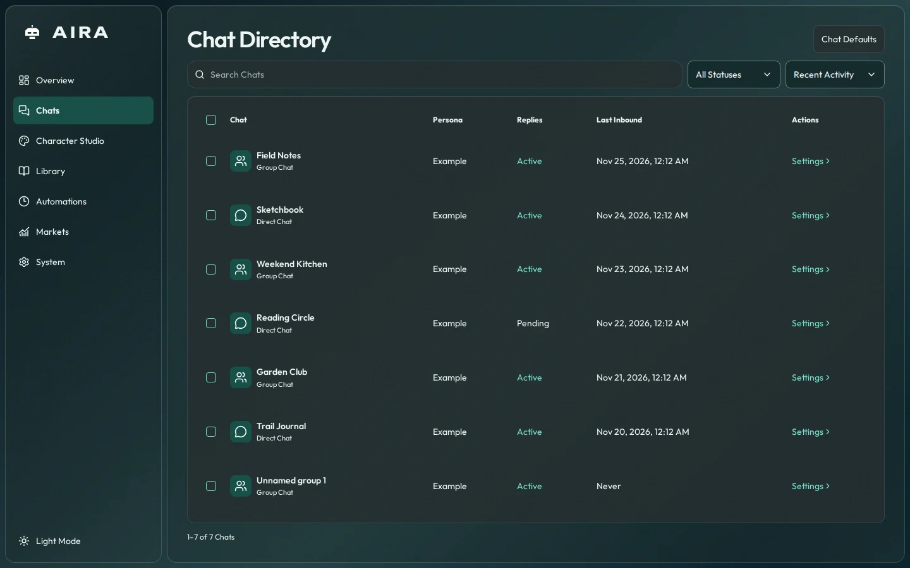
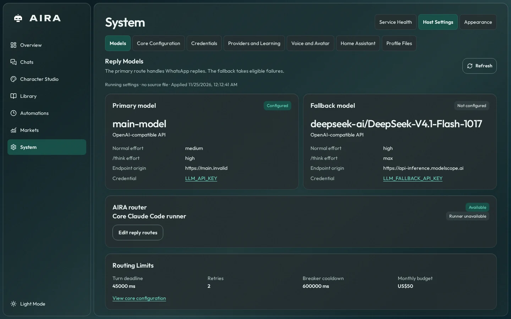
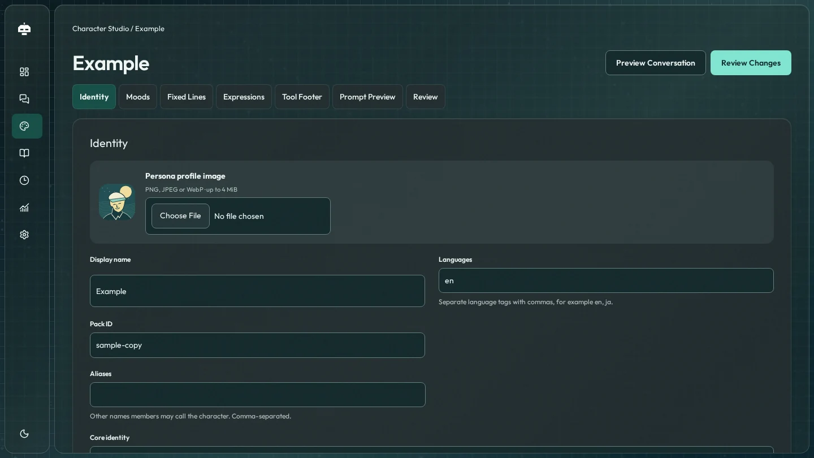
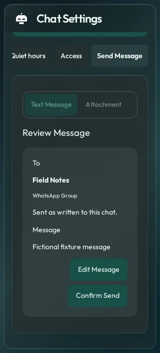
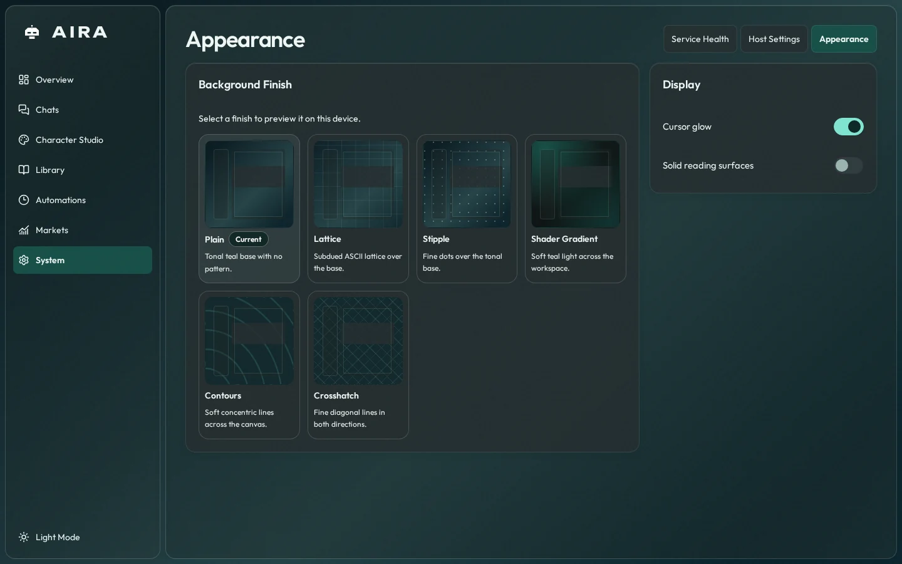

<picture>
  <source media="(prefers-color-scheme: dark)" srcset="docs/images/banner-dark.webp">
  
</picture>

# AIRA

AIRA replies to WhatsApp DMs and small groups in the voice of the character assigned to each chat. The owner
dashboard controls which chats receive replies, which models answer them, and which routines run.

[Quick setup](#quick-setup) · [Open the dashboard](#open-the-owner-dashboard) · [Screenshots](#dashboard) · [Development](#development) · [Operations](#operations)

## A conversation with AIRA

A member asks what to make with rice and an egg, then asks how to get crispy edges. These are replies from the
installed AIRA character in the **WhatsApp Simulator**. The simulator used a fresh chat, the real core and its
configured model routes. Both screenshots show the same exchange.

<picture>
  <source media="(prefers-color-scheme: dark)" srcset="docs/images/whatsapp-dark.webp">
  
</picture>

[Light conversation](docs/images/whatsapp-light.webp) · [Dark conversation](docs/images/whatsapp-dark.webp)

## Quick setup

Try a DM on your computer before connecting a WhatsApp account. You need Node.js 24, Bun and a model API key.

1. Clone the repository and install the core dependencies.

   ```sh
   git clone https://github.com/TolongLabs/AIRA.git
   cd AIRA
   bun install --frozen-lockfile
   ```

2. In this fresh checkout, create a private environment file.

   ```sh
   install -m 600 .env.example .env
   ```

   Open `.env` in your editor and set `LLM_API_KEY`. The bundled `config.yml` selects Anthropic for the
   primary role. For an OpenAI-compatible provider, set `llm.main.provider` to `openai-compatible` and set
   `llm.main.baseUrl`, `llm.main.model` and `llm.main.effort` to values your provider supports.

3. Start the simulator from the repository root. Open the local address it prints, choose the direct chat and
   send a message.

   ```sh
   bun run sim --character example
   ```

   The default address is `http://127.0.0.1:9900`. The public checkout includes the fictional **Example** pack.
   The screenshots above use the private **AIRA** pack from the installed host. To try a pack of your own, place it in
   a dedicated simulator data directory under `characters/<pack-id>/`, then pass `--data <directory> --character <pack-id>`.

For an installation that delivers replies to WhatsApp, connect the Hermes gateway and run the core with Docker
Compose. The install guide covers the data volume, private configuration, gateway media mounts and health check.
[Host installation](docs/trd/deployment.md#install) · [Simulator options](docs/trd/harness.md#whatsapp-simulator)

## Open the owner dashboard

On a host with AIRA and the Hermes owner service installed, open `http://127.0.0.1:9890/overview`.
The published dashboard port is `AIRA_SITE_PORT` (default `9890`). The canonical routes use
`AIRA_DASHBOARD_ENTRY=dashboard`. The entry switch and its rollback are documented in the runbook.
[Dashboard entry switch](docs/trd/deployment.md#dashboard-entry-recovery)

1. **From a laptop**, forward the host's dashboard port. Replace `owner@your-host` with your SSH login.
   Keep the SSH session open while using the dashboard.

   ```sh
   ssh -N -o ExitOnForwardFailure=yes -L 127.0.0.1:9890:127.0.0.1:9890 owner@your-host
   ```

2. Open `http://127.0.0.1:9890/overview` in the laptop browser. At the sign-in prompt, enter the Hermes owner
   site token from the host's `~/.hermes/brain/.site-token` and select **Save token**.
3. Open **System → Host Settings → Models** to inspect the primary and fallback routes. **Credentials** lets
   you set or replace a key. **Apply saved changes** activates edits to the installed configuration.

## Dashboard

The dashboard screenshots use fictional chats and isolated settings. Select an image to inspect a full-size view.

<picture>
  <source media="(prefers-color-scheme: dark)" srcset="docs/images/overview-dark.webp">
  
</picture>

[Light Overview](docs/images/overview-light.webp) · [Dark Overview](docs/images/overview-dark.webp) · [Phone Overview](docs/images/overview-phone.webp)

| Page                                                                                | Light                                                                                               | Dark                                                                                                         |
| ----------------------------------------------------------------------------------- | --------------------------------------------------------------------------------------------------- | ------------------------------------------------------------------------------------------------------------ |
| **Chat Directory** — find a conversation and open its settings.                     | [](docs/images/chats-light.webp)               | [](docs/images/chats-dark.webp)                           |
| **Reply Models** — inspect each role and see which Claude Code paths are available. | [](docs/images/models-light.webp)               | [](docs/images/models-dark.webp)                           |
| **Character Studio** — edit a character’s identity and speech rules.                | [](docs/images/studio-editor.webp)         | [](docs/images/studio-editor-dark.webp)         |
| **Message review** — confirm the chat and message before sending as owner.          | [](docs/images/chat-confirm.webp) | [](docs/images/chat-confirm-dark.webp) |
| **Appearance** — preview background finishes and adjust reading surfaces.           | [](docs/images/appearance-light.webp)         | [](docs/images/appearance-dark.webp)                     |

Character Studio edits identity, speech, moods and fixed lines. Its **Preview Conversation** shows a draft's
configured mood openers. The model-backed simulator in the quick setup runs the full reply pipeline.

## How a Reply Works

1. The Hermes gateway receives a message and passes it to the core. Admission checks the chat and sender.
2. The core loads the character and resolves chat overrides, group or DM defaults and global settings.
3. The turn pipeline builds the prompt, runs permitted tools, formats the reply and records the outcome in SQLite.
4. The gateway returns the reply to the same chat. An owner-written message uses a separate confirmed submission
   with a stable ID so the owner can look up its outcome after a disconnect.


## Repository Layout

```
config.yml              deployment settings, reviewed in git
.env.example            names of every secret, no values
characters/example/     one example character pack; real packs live on the data volume
prompts/                harness prompt blocks shared by all characters
src/
  gateway/              the OpenAI-compatible endpoint and delivery mapping
  turn/                 turn context, admission, the turn pipeline
  character/            pack schema, loader, validator
  prompt/               block assembly, mood detection, reply shape
  format/               cleaning chain, WhatsApp renderer, bubble splitter
  tools/                registry, handlers, command parser, MCP client
  memory/               items, write queue, judge calls, recall, forget
  models/               runners, transports, routing, spend
  records/              turn records, failure records, logger
  settings/             hierarchy resolver, validation, change log
  storage/              database, migrations
  api/                  site API for chatbot pages
site/                   the revamped owner site
scripts/                migration, replay, benchmark, operator tools
tests/                  unit tests and the harness
docs/                   PRD, TRD, runbook, decisions, guides
deploy/                 Dockerfile, compose file, host units
```

## Development

Use Node 24 and Bun. The repository includes one fictional character pack. A local checkout can run the core
contract tests and the browser suite with a temporary database, an owner-service fixture and a fake gateway.

```sh
bun install --frozen-lockfile
(cd site && bun install --frozen-lockfile)
bun run typecheck
bun run lint
bun run format:check
bun run test
bun run --cwd site build
bunx playwright install --with-deps chromium firefox webkit
bun run test:dashboard
```

The core uses TypeScript, SQLite and YAML character packs. The owner site uses React and Vite.
Vitest exercises the core and Playwright drives the built site through the private HTTP listener.

## Operations

Keep real packs on the data volume and credentials in the host's protected configuration.
The runbook covers the private listener, snapshots, deployment health and rollback.
The [operator runbook](docs/RUNBOOK.md) and [deployment contract](docs/trd/deployment.md) give the commands.

## Documentation

| Document                                                  | Covers                                                   |
| --------------------------------------------------------- | -------------------------------------------------------- |
| [Product Requirements](docs/PRD.md)                       | Requirements, user workflows and non-functional targets  |
| [Technical Requirements](docs/TRD.md)                     | Canonical index of contracts, decisions and cross-module |
| [Architecture decision records](docs/decisions/README.md) | Lasting architectural and product choices                |
| [Conventions](docs/CONVENTIONS.md)                        | Repository rules, code style and commit rules            |
| [Runbook](docs/RUNBOOK.md)                                | Host operations, dashboard checks and recovery           |
| [TRD Modules](docs/trd/system.md)                         | Subsystem contracts under `docs/trd/`                    |

## Licence

The dashboard font licences and pattern references are in the [site notes](site/README.md#dashboard-assets).
The README banner combines a generated background with the AIRA glyph and wordmark.

Released under the MIT Licence. Copyright (c) 2026 TolongLabs.
