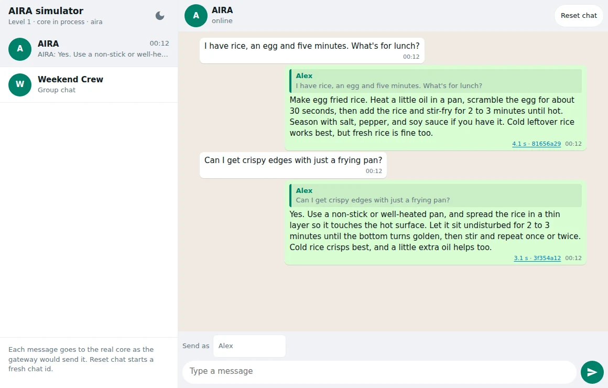

<a id="readme-top"></a>

<div align="center">
  <a href="https://github.com/TolongLabs/AIRA">
    <picture>
      <source media="(prefers-color-scheme: dark)" srcset="docs/images/banner-dark.webp" />
      
    </picture>
  </a>

  <h1>AIRA</h1>
  <p>Self-hosted WhatsApp characters, chat-scoped memory and a private owner dashboard.</p>

[![Release][release-badge]][release-url]
[![CI][ci-badge]][ci-url]
[![Licence][licence-badge]][licence-url]

<a id="table-of-contents"></a>

[Quick Setup](#quick-setup) · [Features](#features) · [Screenshots](#screenshots) ·
[Development](#try-the-simulator) · [Documentation](#documentation) ·
[Report a Bug](https://github.com/TolongLabs/AIRA/issues/new/choose)

</div>

<a id="getting-started"></a>

## Getting Started

AIRA starts its private dashboard before a model or WhatsApp account is connected. Standalone installation
is available from [v1.6.0](https://github.com/TolongLabs/AIRA/releases/tag/v1.6.0).

<a id="prerequisites"></a>

### Prerequisites

- Linux amd64 with systemd, Git and Python 3.10 or later.
- Local rootful [Docker Engine](https://docs.docker.com/engine/) with Compose v2 or later, enabled at boot.
- A non-root installation owner with Docker access and at least 2 GiB of free disk space.

No host Node.js, Bun, model key, Hermes installation or registry login is required to open the dashboard.

<a id="quick-setup"></a>

### Quick Setup

```sh
git clone https://github.com/TolongLabs/AIRA.git
cd AIRA
./aira setup
```

Setup pulls the public `stable` image, creates a private installation and prints the actual dashboard URL.
It finds free loopback ports when the defaults are occupied. The service resumes after boot when Docker is
enabled, unless it was deliberately stopped. Use `./aira` from the checkout or the owner-only launcher path
printed by setup.

<a id="open-the-owner-dashboard"></a>

### Open the Owner Dashboard

1. Run `./aira dashboard`. On a headless or SSH host, use the printed forwarding command on your laptop and
   keep the tunnel open. Use the actual mapped port, not a guessed default.
2. On the host, run `./aira dashboard --show-token` in an interactive owner terminal. Enter the credential
   in the dashboard sign-in form and select **Save token**. Never put the token in a URL or share it.
3. Follow the Overview tasks. In **System Settings**, save and apply a main model revision. The fictional
   **Example** pack is available in Character Studio. A running dashboard does not mean the chatbot is active.
4. With the exact supported public [Hermes v0.23.4](https://github.com/NousResearch/hermes-agent/releases/tag/v0.23.4)
   and an independent configured profile, run `./aira attach-hermes --profile default --dry-run` before a
   deliberate `--apply`. Substitute the selected profile name if needed.

| Task                                | Command                         |
| ----------------------------------- | ------------------------------- |
| Find the dashboard or service state | `aira dashboard`, `aira status` |
| Diagnose a failure                  | `aira doctor`, `aira logs`      |
| Read saved settings                 | `aira config get`               |
| Resume or update                    | `aira setup`, `aira update`     |
| Restore a verified copy             | `aira restore --help`           |

The [installation guide](docs/INSTALL.md) covers exact attachment, credentials, CLI flags, supported platforms,
updates and recovery. Existing legacy installations retain their owner authority and deployment channel;
`aira status`, `aira dashboard`, `aira doctor` and `aira logs` discover them without restarting or migrating them.

> **Privacy:** Never commit `.env`, real character packs or real chat data. Keep private packs on the owner's
> data volume and credentials in protected installation/host configuration. Only the fictional `example` pack
> belongs in this repository.

<a id="about-the-project"></a>

## About the Project

AIRA replies to WhatsApp DMs and small groups in the voice of the character assigned to each chat, behind the
Hermes Agent gateway. Each chat has its own settings and memory. The owner chooses which chats may receive
replies, which model answers them and which routines run.

A character pack defines identity, speech, moods and optional stickers. The core uses code to resolve settings,
shape and clean replies, format WhatsApp bubbles and store typed records. The same character and tool rules
apply when a model falls back to another provider.

<a id="features"></a>

### Features

- **Characters:** per-chat packs, mood detection, reply shaping and WhatsApp formatting.
- **Chat Controls:** global, DM/group and individual chat settings, with the nearest override taking precedence.
- **Memory:** typed facts, episodes and media scoped to their originating chat, with controlled recall and forgetting.
- **Tools:** one registry for model tools and slash commands, including search, research and document generation.
- **Owner Console:** manage characters, chats, models and supported settings through protected routes.
- **Reliability:** bounded model fallback, receipts for state changes, turn/failure records and offline replay.

<a id="supported-modes"></a>

### Supported Modes

| Mode       | Verified Scope                                                                                                                         |
| ---------- | -------------------------------------------------------------------------------------------------------------------------------------- |
| Standalone | Private dashboard and ordinary admitted WhatsApp text through the exact supported Hermes version.                                      |
| Legacy     | Existing host-managed integration, including its broader media, sticker, reaction, scheduling and owner integrations where configured. |

Standalone first boot is keyless and does not require Hermes. Its synthetic release verification does not establish
real account pairing or delivery. Do not assume legacy media, host tools, subscription runner or scheduled messages
are available on standalone. The [installation guide](docs/INSTALL.md) is the supported compatibility reference;
requirement status and known gaps are tracked in [PRD](docs/PRD.md#functional-requirements) and
[Traceability](docs/trd/traceability.md).

<a id="a-conversation-with-aira"></a>

## Screenshots

<a id="screenshots"></a>

The conversation below uses a fresh fictional chat in the model-backed WhatsApp simulator. It runs the actual
reply pipeline without sending a WhatsApp message.

<p align="center">
  <picture>
    <source media="(prefers-color-scheme: dark)" srcset="docs/images/whatsapp-dark.webp" />
    
  </picture>
</p>

The legacy owner dashboard example uses fictional chats and isolated settings. Standalone exposes only its
verified capabilities.

<p align="center">
  <picture>
    <source media="(prefers-color-scheme: dark)" srcset="docs/images/overview-dark.webp" />
    
  </picture>
</p>

More views: [Chat Directory](docs/images/chats-light.webp) · [Models](docs/images/models-light.webp) ·
[Character Studio](docs/images/studio-editor.webp) · [Appearance](docs/images/appearance-light.webp) ·
[Phone Overview](docs/images/overview-phone.webp) · [Legacy Message Review](docs/images/chat-confirm.webp).

<a id="how-a-reply-works"></a>
<a id="architecture"></a>
<a id="project-structure"></a>
<a id="tech-stack"></a>

## Architecture

Hermes is the transport; the TypeScript core owns the turn. The core resolves chat identity and character,
assembles the prompt, runs permitted tools and the model, then formats the reply and records the outcome.
The gateway returns the reply to the originating chat. State is written through one core-owned SQLite store.

The main stack is TypeScript, Node.js 24, Bun, Google Agent Development Kit, SQLite, React, Vite, Tailwind CSS,
Vitest, Playwright and Docker. `src/` holds the core, `site/` the dashboard, `deploy/` the host CLI and gateway
adapters, `tests/` the synthetic test layers and `docs/` the contracts and operator guides.

Read the [system overview](docs/diagrams/system-overview.svg), [one-turn walkthrough](docs/trd/system.md#one-turn)
and [technical requirements](docs/TRD.md) for details. The [diagrams index](docs/diagrams/README.md) links the
subsystem designs and the core contract modules.

<a id="try-the-simulator"></a>

## Development

<a id="try-the-simulator-development"></a>

### Try the Simulator

Use a separate checkout with [Node.js](https://nodejs.org/) 24, [Bun](https://bun.sh/) (the version in
`package.json`) and a model API key. In a fresh checkout, create a private environment file:

```sh
bun install --frozen-lockfile
install -m 600 .env.example .env
```

Set `LLM_API_KEY` in the private `.env`. The bundled configuration selects Anthropic for the main role.
For an OpenAI-compatible provider, configure `llm.main.provider`, `llm.main.baseUrl`, `llm.main.model`
and `llm.main.effort`.

```sh
bun run sim --character example
```

Open the printed address (default `http://127.0.0.1:9900`) and choose the direct chat. To try a private pack,
use a dedicated simulator data directory with `characters/<pack-id>/`, and pass `--data <directory>
--character <pack-id>`. See [Simulator Options](docs/trd/harness.md#whatsapp-simulator).

<a id="run-tests"></a>

### Run Tests

The core and browser suites use temporary databases, an owner-service fixture and a fake gateway.

```sh
bun install --frozen-lockfile
(cd site && bun install --frozen-lockfile)
bun run typecheck
bun run lint
bun run format:check
bun run test
bun run --cwd site build
bunx playwright install --with-deps chromium firefox webkit
bun run test:dashboard
```

The [test harness](docs/trd/harness.md) describes the layers, simulator, replay and acceptance thresholds.

<a id="documentation"></a>
<a id="links"></a>
<a id="operations"></a>
<a id="rules-across-modules"></a>
<a id="engineering-highlights"></a>

## Documentation

| Resource                                     | Purpose                                           |
| -------------------------------------------- | ------------------------------------------------- |
| [Installation](docs/INSTALL.md)              | Standalone setup, compatibility, CLI and updates  |
| [Product Requirements](docs/PRD.md)          | Features and requirement status                   |
| [Technical Requirements](docs/TRD.md)        | Architecture, module contracts and shared rules   |
| [Traceability](docs/trd/traceability.md)     | Code, tests and gaps per requirement              |
| [Decision Records](docs/decisions/README.md) | Architecture and deployment decisions             |
| [Runbook](docs/RUNBOOK.md)                   | Legacy deployment, health, snapshots and recovery |
| [Maintaining](docs/MAINTAINING.md)           | Component changes and maintenance                 |
| [Conventions](docs/CONVENTIONS.md)           | Coding and repository standards                   |
| [Release Notes](CHANGELOG.md)                | Changes in each release                           |

AIRA's shared rules cover strict chat isolation, bounded tool execution, one core writer, receipts for actions
and records for failures. The [technical requirements](docs/TRD.md#rules-across-modules) define these rules;
[readiness measurements](docs/READINESS.md) record the original verified cutover evidence. Keep production
configuration and private data outside the source checkout.

<a id="contributing"></a>

## Contributing

Follow [CONTRIBUTING.md](CONTRIBUTING.md) and the [Git workflow](docs/references/git-workflow.md): use a branch,
small commits, a pull request and the required checks before rebase-merge. Change the owning TRD contract before
changing its code. The same checks apply to coding agents under [AGENTS.md](AGENTS.md). Report vulnerabilities
through [SECURITY.md](SECURITY.md).

<a id="maintainers"></a>

## Maintainers

- [@AlaskanTuna](https://github.com/AlaskanTuna)
- [@chaosiris](https://github.com/chaosiris)

<a id="ai-disclosure"></a>

## AI Disclosure

Coding agents work under the repository's rules and required checks. Nobody bypasses the `main` ruleset.
The README banner combines a generated background with the AIRA glyph and wordmark.

<a id="licence"></a>

## Licence

Copyright (c) 2026 TolongLabs. All rights reserved. [TolongLabs Proprietary Source-Available Licence 1.0](LICENSE).
Dashboard font licences and pattern references are in the [site notes](site/README.md#dashboard-assets).

<a id="acknowledgements"></a>

## Acknowledgements

- Hermes Agent, the WhatsApp transport.
- [Google Agent Development Kit](https://google.github.io/adk-docs/) and
  [Model Context Protocol](https://modelcontextprotocol.io/).
- [Shields.io](https://shields.io), for the badges.

[release-badge]: https://img.shields.io/github/v/release/TolongLabs/AIRA?style=for-the-badge
[release-url]: https://github.com/TolongLabs/AIRA/releases
[ci-badge]: https://img.shields.io/github/actions/workflow/status/TolongLabs/AIRA/ci.yml?branch=main&style=for-the-badge&label=CI
[ci-url]: https://github.com/TolongLabs/AIRA/actions/workflows/ci.yml
[licence-badge]: https://img.shields.io/badge/Licence-Source--Available-0F766E?style=for-the-badge
[licence-url]: LICENSE
