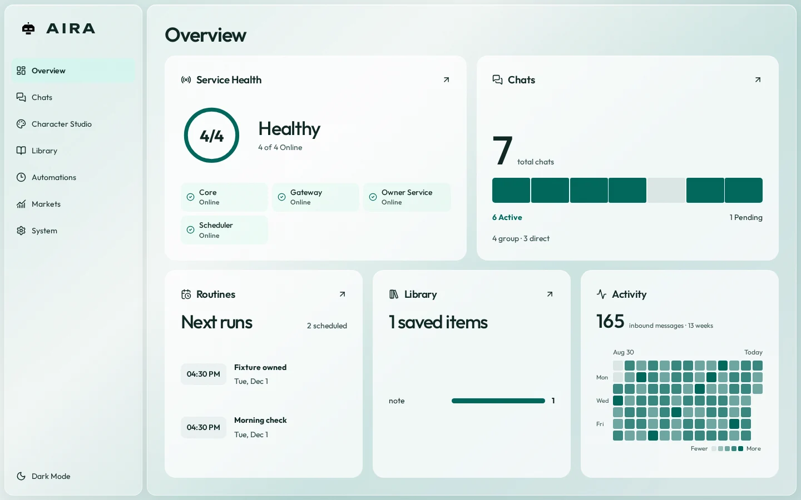
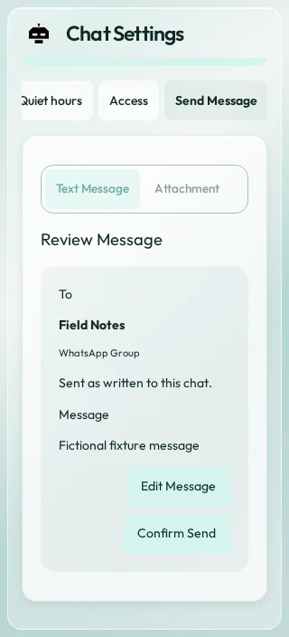

<a id="readme-top"></a>

<!-- PROJECT BANNER -->

<br />
<div align="center">
  <a href="https://github.com/TolongLabs/AIRA">
    <picture>
      <source media="(prefers-color-scheme: dark)" srcset="docs/images/banner-dark.webp" />
      
    </picture>
  </a>

  <h1>AIRA</h1>

  <p>
    Self-hosted WhatsApp characters, chat-scoped memory and a private owner dashboard.
    <br />
    <a href="#quick-setup"><strong>Quick Setup &rarr;</strong></a>
    &middot;
    <a href="#open-the-owner-dashboard">Open The Dashboard</a>
    &middot;
    <a href="#screenshots">Screenshots</a>
    &middot;
    <a href="#documentation">Documentation</a>
    &middot;
    <a href="https://github.com/TolongLabs/AIRA/issues/new/choose">Report A Bug</a>
    <br />
  </p>

[![Release][release-badge]][release-url]
[![CI][ci-badge]][ci-url]
[![Licence][licence-badge]][licence-url]
[![TypeScript][typescript-badge]][typescript-url]
[![Node.js][node-badge]][node-url]
[![Bun][bun-badge]][bun-url]
[![SQLite][sqlite-badge]][sqlite-url]
[![DuckDB][duckdb-badge]][duckdb-url]
[![Zod][zod-badge]][zod-url]
[![React][react-badge]][react-url]
[![Vite][vite-badge]][vite-url]
[![Tailwind CSS][tailwindcss-badge]][tailwindcss-url]
[![Vitest][vitest-badge]][vitest-url]
[![Playwright][playwright-badge]][playwright-url]
[![Docker][docker-badge]][docker-url]

</div>

<!-- TABLE OF CONTENTS -->

## Table Of Contents

<details>
  <summary>Expand</summary>
  <ol>
    <li>
      <a href="#about-the-project">About The Project</a>
      <ul>
        <li><a href="#links">Links</a></li>
        <li><a href="#a-conversation-with-aira">A Conversation With AIRA</a></li>
        <li><a href="#screenshots">Screenshots</a></li>
        <li><a href="#how-a-reply-works">How A Reply Works</a></li>
        <li><a href="#features">Features</a></li>
        <li><a href="#architecture">Architecture</a></li>
        <li><a href="#project-structure">Project Structure</a></li>
        <li><a href="#tech-stack">Tech Stack</a></li>
      </ul>
    </li>
    <li>
      <a href="#getting-started">Getting Started</a>
      <ul>
        <li><a href="#prerequisites">Prerequisites</a></li>
        <li><a href="#quick-setup">Quick Setup</a></li>
        <li><a href="#open-the-owner-dashboard">Open The Owner Dashboard</a></li>
        <li><a href="#try-the-simulator">Try The Simulator (Development)</a></li>
        <li><a href="#run-tests">Run Tests</a></li>
      </ul>
    </li>
    <li><a href="#operations">Operations</a></li>
    <li><a href="#rules-across-modules">Rules Across Modules</a></li>
    <li><a href="#engineering-highlights">Engineering Highlights</a></li>
    <li><a href="#documentation">Documentation</a></li>
    <li><a href="#contributing">Contributing</a></li>
    <li><a href="#maintainers">Maintainers</a></li>
    <li><a href="#ai-disclosure">AI Disclosure</a></li>
    <li><a href="#licence">Licence</a></li>
    <li><a href="#acknowledgements">Acknowledgements</a></li>
  </ol>
</details>

<!-- ABOUT THE PROJECT -->

<a id="about-the-project"></a>

## About The Project

AIRA replies to WhatsApp DMs and small groups through the Hermes Agent gateway on a private Linux host.
Each chat has **one character pack and its own settings**.

Code, not prompt wording, handles voice, mood and WhatsApp formatting. **One agent loop, one tool set and one voice** apply across models.

Typed memory stays in its originating chat in **one SQLite file**. Turn and failure records support offline replay.

<a id="links"></a>

### Links

| Resource               | Link                                                                                              |
| ---------------------- | ------------------------------------------------------------------------------------------------- |
| Product Requirements   | [`docs/PRD.md`](docs/PRD.md), requirements and status                                             |
| Technical Requirements | [`docs/TRD.md`](docs/TRD.md), module contracts                                                    |
| Requirement Status     | [`docs/trd/traceability.md`](docs/trd/traceability.md), code, tests and gaps                      |
| Decision Records       | [`docs/decisions/`](docs/decisions/README.md), design decisions                                   |
| Runbook                | [`docs/RUNBOOK.md`](docs/RUNBOOK.md), operations and recovery                                     |
| Installation           | [`docs/INSTALL.md`](docs/INSTALL.md), standalone setup and troubleshooting                        |
| Releases               | [GitHub Releases](https://github.com/TolongLabs/AIRA/releases) and [`CHANGELOG.md`](CHANGELOG.md) |

<p align="right"><a href="#readme-top">&uarr;</a></p>

<a id="a-conversation-with-aira"></a>

### A Conversation With AIRA

A fictional conversation in the **WhatsApp Simulator** uses the actual core and model routes, without sending
a WhatsApp message.

<p align="center">
  <picture>
    <source media="(prefers-color-scheme: dark)" srcset="docs/images/whatsapp-dark.webp" />
    
  </picture>
</p>

[Light Conversation](docs/images/whatsapp-light.webp) · [Dark Conversation](docs/images/whatsapp-dark.webp)

<p align="right"><a href="#readme-top">&uarr;</a></p>

<a id="screenshots"></a>

### Screenshots

The legacy dashboard screenshots use fictional chats, isolated settings and your GitHub theme.

<p align="center">
  <picture>
    <source media="(prefers-color-scheme: dark)" srcset="docs/images/overview-dark.webp" />
    
  </picture>
</p>

[Light Overview](docs/images/overview-light.webp) · [Dark Overview](docs/images/overview-dark.webp) ·
[Phone Overview](docs/images/overview-phone.webp)

<table>
  <tr>
    <td width="50%" valign="top" align="left">
      <picture>
        <source media="(prefers-color-scheme: dark)" srcset="docs/images/chats-dark.webp" />
        
      </picture>
      <br />
      <strong>Chat Directory</strong> · Find and configure chats.
    </td>
    <td width="50%" valign="top" align="left">
      <picture>
        <source media="(prefers-color-scheme: dark)" srcset="docs/images/models-dark.webp" />
        
      </picture>
      <br />
      <strong>Reply Models</strong> · Inspect model roles and available runners.
    </td>
  </tr>
  <tr>
    <td width="50%" valign="top" align="left">
      <picture>
        <source media="(prefers-color-scheme: dark)" srcset="docs/images/studio-editor-dark.webp" />
        
      </picture>
      <br />
      <strong>Character Studio</strong> · Edit identity and speech.
    </td>
    <td width="50%" valign="top" align="left">
      <picture>
        <source media="(prefers-color-scheme: dark)" srcset="docs/images/appearance-dark.webp" />
        
      </picture>
      <br />
      <strong>Appearance</strong> · Adjust the dashboard appearance.
    </td>
  </tr>
  <tr>
    <td width="50%" valign="top" align="center">
      <picture>
        <source media="(prefers-color-scheme: dark)" srcset="docs/images/chat-confirm-dark.webp" />
        
      </picture>
      <br />
      <strong>Message Review</strong> · Confirm an owner message.
    </td>
    <td width="50%" valign="top" align="center">
      
      <br />
      <strong>Phone Overview</strong> · Mobile dashboard.
    </td>
  </tr>
</table>

Character Studio previews draft mood openers; the [developer simulator](#try-the-simulator) runs the full reply pipeline.

<p align="right"><a href="#readme-top">&uarr;</a></p>

<a id="how-a-reply-works"></a>

### How A Reply Works

<p align="center">
  
</p>

1. **Receive.** Hermes passes the message to the core, which checks the chat and sender.
2. **Resolve.** Load the character and nearest settings override.
3. **Run.** Build the prompt, run permitted tools, format the reply and record it in SQLite.
4. **Return.** Hermes replies to the same chat. Legacy owner messages use confirmed submissions with stable IDs.

[`docs/trd/system.md`](docs/trd/system.md#one-turn) explains each step.

<p align="right"><a href="#readme-top">&uarr;</a></p>

<a id="features"></a>

### Features

| Feature                    | What A Chat Gets                                                     |
| -------------------------- | -------------------------------------------------------------------- |
| **One Character Per Chat** | Identity, speech, moods, error lines and optional stickers           |
| **Per-Chat Settings**      | Global, chat-type and chat overrides; nearest wins                   |
| **Mood And Reply Shape**   | Rule-based mood detection and reply shaping without model cost       |
| **WhatsApp Formatting**    | Cleaned WhatsApp markup and bubble splitting                         |
| **Tools And Commands**     | One model/slash-command registry, timeouts and receipts              |
| **Memory That Holds**      | Chat-scoped facts, episodes and media; fail-closed memory admission  |
| **Media And Social Posts** | Bounded media watching; social-link intake in legacy mode            |
| **Research And Documents** | Background research and PDF/document generation                      |
| **Model Fallback**         | Shared runner, bounded retries and monthly spend cap                 |
| **Records And A Harness**  | Turn/failure records, replay, simulators and benchmarks              |
| **Owner Dashboard**        | Private console for chats, models, characters and supported routines |

See [`docs/PRD.md`](docs/PRD.md#functional-requirements) and [`docs/trd/traceability.md`](docs/trd/traceability.md)
for requirement status. Features differ by mode; standalone uses explicitly negotiated capabilities.

<p align="right"><a href="#readme-top">&uarr;</a></p>

<a id="architecture"></a>

### Architecture

**The gateway** handles WhatsApp transport. **The core** resolves the chat, runs the turn and records the result.

| Item         | Value                                                                     |
| ------------ | ------------------------------------------------------------------------- |
| Core         | TypeScript service on Node 24                                             |
| Transport    | Host Hermes; legacy or pinned standalone adapter                          |
| Attach Point | Legacy OpenAI-compatible API; authenticated standalone loopback transport |
| Store        | Core-owned SQLite file on mounted volume                                  |
| Model Loop   | Google ADK API runner; legacy `claude` subscription runner                |
| Judge Model  | Small model for mood and memory checks                                    |

Contracts: [`docs/TRD.md`](docs/TRD.md). Diagrams: [`docs/diagrams/`](docs/diagrams/README.md).

<p align="right"><a href="#readme-top">&uarr;</a></p>

<a id="project-structure"></a>

### Project Structure

```
AIRA/
├── aira                 portable host CLI launcher
├── config.yml           deployment settings
├── .env.example         secret names only
├── characters/example/  fictional pack; real packs stay private
├── prompts/             shared prompt blocks
├── src/                 the core service
│   ├── gateway/             legacy and standalone transports
│   ├── turn/                turn context, admission, pipeline
│   ├── character/           pack schema, loader, validator
│   ├── prompt/              block assembly, mood detection, reply shape
│   ├── format/              cleaning, rendering, splitting
│   ├── tools/               registry, handlers, command parser, MCP client
│   ├── memory/              items, write queue, recall, forget
│   ├── judge/               judge model
│   ├── models/              runners, transports, routing, spend
│   ├── media/               media and link intake
│   ├── social/              social post readers
│   ├── research/            `/research` background jobs
│   ├── render/              report renderer
│   ├── feedback/            `/report` links and answer sync
│   ├── records/             turn/failure records and logging
│   ├── settings/            settings hierarchy and validation
│   ├── storage/             database, migrations
│   ├── config/              `config.yml` schema and loader
│   ├── migration/           legacy imports
│   └── api/                 site API
├── site/                owner dashboard
├── tests/               test suites
├── bench/               benchmark sets
├── live/                live check sets
├── scripts/             migration, replay, benchmark and operator tools
├── deploy/              Dockerfile, Compose templates, CLI, gateway adapters and host units
└── docs/                contracts, guides, diagrams, images
```

<p align="right"><a href="#readme-top">&uarr;</a></p>

<a id="tech-stack"></a>

### Tech Stack

| Layer           | Technology                                               |
| --------------- | -------------------------------------------------------- |
| Language        | Strict TypeScript, ES modules                            |
| Runtime         | Node 24, Bun package manager/runner                      |
| Model Loop      | `@google/adk`, Anthropic SDK                             |
| Tool Servers    | `@modelcontextprotocol/sdk`                              |
| Validation      | Zod schemas                                              |
| Store           | SQLite (`better-sqlite3`)                                |
| Analytics       | DuckDB (reports/benchmarks only)                         |
| Owner Dashboard | React 19, Vite 7, Tailwind CSS 4, Radix UI               |
| Tests           | Vitest, Playwright                                       |
| Tooling         | Biome, Prettier, Husky, commitlint, gitleaks, Dependabot |
| Deployment      | Container; legacy CI or standalone stable                |
| Off-Host Backup | Encrypted restic, at most 15 minutes old                 |

<p align="right"><a href="#readme-top">&uarr;</a></p>

<!-- GETTING STARTED -->

<a id="getting-started"></a>

## Getting Started

Standalone installation, available from [v1.6.0](https://github.com/TolongLabs/AIRA/releases/tag/v1.6.0), opens
the private dashboard before a model or WhatsApp account is connected. Legacy installations are unchanged.

<a id="prerequisites"></a>

### Prerequisites

- Linux amd64 with systemd, Git and Python 3.10 or later
- Local rootful [Docker Engine](https://docs.docker.com/engine/) with Compose v2 or later, enabled at boot
- A non-root installation owner with Docker access and at least 2 GiB of free disk space

No host Node.js, Bun, model key, Hermes or registry login is needed for setup.

<a id="quick-setup"></a>

### Quick Setup

```sh
git clone https://github.com/TolongLabs/AIRA.git
cd AIRA
./aira setup
```

Setup pulls the public `stable` image, selects free loopback ports and prints the dashboard URL. The service
resumes with Docker unless deliberately stopped. Use `./aira` or the printed owner-only launcher.

> **Never Commit `.env`, A Real Character Pack, Or Real Chat Data.** Only the fictional `example` pack belongs in
> `characters/`.

<a id="open-the-owner-dashboard"></a>

### Open The Owner Dashboard

1. Run `./aira dashboard`. On SSH, use the printed forwarding command on your laptop and keep the tunnel open.
2. Run `./aira dashboard --show-token` in an interactive owner terminal. Enter the token and select **Save token**.
   Never put it in a URL or share it.
3. Follow the Overview tasks: save and apply a main model in **System Settings**. The fictional **Example** pack
   is ready in Character Studio. Dashboard readiness does not mean chatbot readiness.
4. With exact supported [Hermes v0.23.4](https://github.com/NousResearch/hermes-agent/releases/tag/v0.23.4)
   and an independent profile, review `./aira attach-hermes --profile default --dry-run` before `--apply`.
   Substitute the selected profile if needed.

| Need                         | Command                         |
| ---------------------------- | ------------------------------- |
| Discover URL or verify state | `aira dashboard`, `aira status` |
| Diagnose a failure           | `aira doctor`, `aira logs`      |
| Manage saved settings        | `aira config get`               |
| Resume or update             | `aira setup`, `aira update`     |
| Restore a verified copy      | `aira restore --help`           |

The [installation and troubleshooting guide](docs/INSTALL.md) covers attachment, CLI flags, recovery and
capability evidence. Synthetic verification did not test real pairing or delivery. Legacy discovery commands
do not restart or migrate existing installations.

<a id="try-the-simulator"></a>

### Try The Simulator (Development)

Use a separate checkout with [Node.js](https://nodejs.org/) 24, [Bun](https://bun.sh/) (pinned in
`package.json`) and a model API key.

```sh
bun install --frozen-lockfile
install -m 600 .env.example .env
```

Set `LLM_API_KEY` in private `.env`. The default model provider is Anthropic. For OpenAI-compatible providers,
set `llm.main.provider`, `llm.main.baseUrl`, `llm.main.model` and `llm.main.effort`.

```sh
bun run sim --character example
```

Open the printed URL (default `http://127.0.0.1:9900`) and choose the direct chat. For private packs, use
`characters/<pack-id>/` in a separate simulator data directory and pass `--data <directory> --character <pack-id>`.
[Simulator Options](docs/trd/harness.md#whatsapp-simulator)

<a id="run-tests"></a>

### Run Tests

Core and browser tests use temporary databases, an owner-service fixture and a fake gateway.

```sh
bun install --frozen-lockfile
(cd site && bun install --frozen-lockfile)
bun run typecheck
bun run lint
bun run format:check
bun run test
bun run --cwd site build
bunx playwright install --with-deps chromium firefox webkit
bun run test:dashboard
```

Test layers and acceptance gates: [`docs/trd/harness.md`](docs/trd/harness.md).

<p align="right"><a href="#readme-top">&uarr;</a></p>

<a id="operations"></a>

## Operations

Keep real packs and credentials outside the checkout. See the [operator runbook](docs/RUNBOOK.md) and
[deployment contract](docs/trd/deployment.md) for legacy operations, or the [installation guide](docs/INSTALL.md)
for standalone setup and recovery.

<p align="right"><a href="#readme-top">&uarr;</a></p>

<a id="rules-across-modules"></a>

## Rules Across Modules

Every module follows these [TRD rules](docs/TRD.md#rules-across-modules). Change the contract first.

| Rule                                         | What It Means                                           |
| -------------------------------------------- | ------------------------------------------------------- |
| **SQLite Is Canonical**                      | One core writer; authored packs stay as files           |
| **Identity Comes From Code**                 | The gateway/code resolves chat, sender and character    |
| **A Fact Never Leaves Its Chat**             | Memory, style and behaviour are chat-scoped             |
| **One Loop, One Tool Set, One Voice**        | Fallback changes only the model                         |
| **The Character Pack Is The Persona Source** | No character names, traits or phrases in code           |
| **Every State Change Has A Receipt**         | A reply claims an action only with a code-built receipt |
| **Every Turn Leaves A Record**               | Turns and failures write records with turn IDs          |
| **Untrusted Text Is Labelled**               | User, page, media and tool text is labelled             |
| **The System Prompt Has A Size Cap**         | Tests enforce the prompt token ceiling                  |

<p align="right"><a href="#readme-top">&uarr;</a></p>

<a id="engineering-highlights"></a>

## Engineering Highlights

- **Invariants As Gates.** CI checks prompt size, markup, privacy and the absence of live calls in offline tests.
- **A Memory Simulator With Ground Truth.** Tests isolation, concurrency, crash recovery, recall and forgetting.
- **Restart Safety By Rule.** Durable work states prevent lost writes, duplicate replies and stuck leases.
- **Forgetting That Removes.** Delete a fact by ID and prevent pending memory work from restoring it.
- **A WhatsApp Simulator.** Preview formatting, bubble order and stickers without WhatsApp.
- **Measured, Not Asserted.** Original cutover metrics: [`docs/READINESS.md`](docs/READINESS.md).
- **Decisions On Record.** Dated design choices: [`docs/decisions/`](docs/decisions/README.md).

<p align="right"><a href="#readme-top">&uarr;</a></p>

<a id="documentation"></a>

## Documentation

| Question                             | Document                                                                                             |
| ------------------------------------ | ---------------------------------------------------------------------------------------------------- |
| What must it do, and for whom?       | [`docs/PRD.md`](docs/PRD.md)                                                                         |
| How is it built?                     | [`docs/TRD.md`](docs/TRD.md) and its modules, starting at [`docs/trd/system.md`](docs/trd/system.md) |
| How far does each requirement stand? | [`docs/trd/traceability.md`](docs/trd/traceability.md), [`docs/READINESS.md`](docs/READINESS.md)     |
| Why is it built this way?            | [`docs/decisions/`](docs/decisions/README.md)                                                        |
| How is it deployed and operated?     | [`docs/RUNBOOK.md`](docs/RUNBOOK.md), [`docs/trd/deployment.md`](docs/trd/deployment.md)             |
| How do I install or troubleshoot?    | [`docs/INSTALL.md`](docs/INSTALL.md)                                                                 |
| How do I change or extend a part?    | [`docs/MAINTAINING.md`](docs/MAINTAINING.md)                                                         |
| What are the house rules?            | [`docs/CONVENTIONS.md`](docs/CONVENTIONS.md), [`docs/references/`](docs/references/)                 |
| How do coding agents work here?      | [`AGENTS.md`](AGENTS.md)                                                                             |
| How do I report a vulnerability?     | [`SECURITY.md`](SECURITY.md)                                                                         |

<p align="right"><a href="#readme-top">&uarr;</a></p>

<a id="contributing"></a>

## Contributing

Use a branch, small commits, a pull request and rebase merge. See [`CONTRIBUTING.md`](CONTRIBUTING.md) and
[`docs/references/git-workflow.md`](docs/references/git-workflow.md). Change the owning TRD contract before code.

<p align="right"><a href="#readme-top">&uarr;</a></p>

<!-- MAINTAINERS -->

<a id="maintainers"></a>

## Maintainers

<div align="center">
<table>
  <tr>
    <td align="center" valign="top" width="50%">
      <a href="https://github.com/AlaskanTuna"></a><br />
      <a href="https://github.com/AlaskanTuna"><b>@AlaskanTuna</b></a>
    </td>
    <td align="center" valign="top" width="50%">
      <a href="https://github.com/chaosiris"></a><br />
      <a href="https://github.com/chaosiris"><b>@chaosiris</b></a>
    </td>
  </tr>
</table>
</div>

<p align="right"><a href="#readme-top">&uarr;</a></p>

<a id="ai-disclosure"></a>

## AI Disclosure

Coding agents follow [`AGENTS.md`](AGENTS.md) and the same required checks as everyone else.
The banner combines a generated background with the AIRA glyph and wordmark.

<p align="right"><a href="#readme-top">&uarr;</a></p>

<!-- LICENCE -->

<a id="licence"></a>

## Licence

Copyright (c) 2026 TolongLabs. All rights reserved.
[TolongLabs Proprietary Source-Available Licence 1.0](LICENSE)

The dashboard font licences and pattern references are in the [site notes](site/README.md#dashboard-assets).

<p align="right"><a href="#readme-top">&uarr;</a></p>

<!-- ACKNOWLEDGEMENTS -->

<a id="acknowledgements"></a>

## Acknowledgements

- Hermes Agent, the WhatsApp transport AIRA sits behind
- [Google Agent Development Kit](https://google.github.io/adk-docs/), the model loop of the API runner
- [Model Context Protocol](https://modelcontextprotocol.io/), for external tool servers
- [Shields.io](https://shields.io), for the badges

<p align="right"><a href="#readme-top">&uarr;</a></p>

<!-- MARKDOWN LINKS & IMAGES -->

[release-badge]: https://img.shields.io/github/v/release/TolongLabs/AIRA?style=for-the-badge
[release-url]: https://github.com/TolongLabs/AIRA/releases
[ci-badge]: https://img.shields.io/github/actions/workflow/status/TolongLabs/AIRA/ci.yml?branch=main&style=for-the-badge&label=CI
[ci-url]: https://github.com/TolongLabs/AIRA/actions/workflows/ci.yml
[licence-badge]: https://img.shields.io/badge/Licence-Source--Available-0F766E?style=for-the-badge
[licence-url]: LICENSE
[typescript-badge]: https://img.shields.io/badge/TypeScript-3178C6?style=for-the-badge&logo=typescript&logoColor=white
[typescript-url]: https://www.typescriptlang.org/
[node-badge]: https://img.shields.io/badge/Node.js-5FA04E?style=for-the-badge&logo=nodedotjs&logoColor=white
[node-url]: https://nodejs.org/
[bun-badge]: https://img.shields.io/badge/Bun-000000?style=for-the-badge&logo=bun&logoColor=white
[bun-url]: https://bun.sh/
[sqlite-badge]: https://img.shields.io/badge/SQLite-003B57?style=for-the-badge&logo=sqlite&logoColor=white
[sqlite-url]: https://www.sqlite.org/
[duckdb-badge]: https://img.shields.io/badge/DuckDB-FFF000?style=for-the-badge&logo=duckdb&logoColor=black
[duckdb-url]: https://duckdb.org/
[zod-badge]: https://img.shields.io/badge/Zod-408AFF?style=for-the-badge&logo=zod&logoColor=white
[zod-url]: https://zod.dev/
[react-badge]: https://img.shields.io/badge/React-61DAFB?style=for-the-badge&logo=react&logoColor=black
[react-url]: https://react.dev/
[vite-badge]: https://img.shields.io/badge/Vite-9135FF?style=for-the-badge&logo=vite&logoColor=white
[vite-url]: https://vite.dev/
[tailwindcss-badge]: https://img.shields.io/badge/Tailwind_CSS-06B6D4?style=for-the-badge&logo=tailwindcss&logoColor=white
[tailwindcss-url]: https://tailwindcss.com/
[vitest-badge]: https://img.shields.io/badge/Vitest-6E9F18?style=for-the-badge&logo=vitest&logoColor=white
[vitest-url]: https://vitest.dev/
[playwright-badge]: https://img.shields.io/badge/Playwright-2EAD33?style=for-the-badge&logo=playwright&logoColor=white
[playwright-url]: https://playwright.dev/
[docker-badge]: https://img.shields.io/badge/Docker-2496ED?style=for-the-badge&logo=docker&logoColor=white
[docker-url]: https://www.docker.com/
