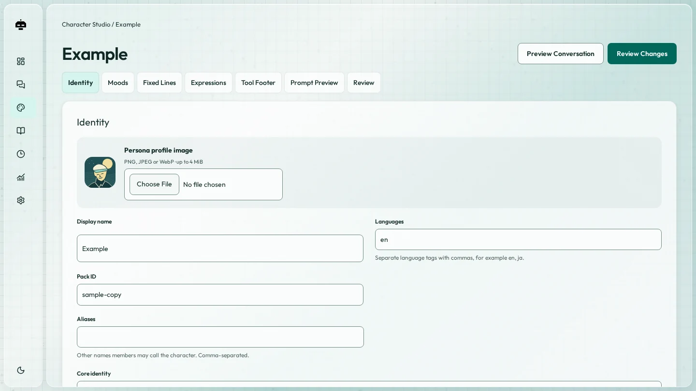

<picture>
  <source media="(prefers-color-scheme: dark)" srcset="docs/images/banner-dark.webp">
  
</picture>

# AIRA

AIRA answers WhatsApp DMs and small groups as the character configured for each chat. An owner can change who receives
replies, choose a character and inspect service health from a private dashboard on the same Linux host.

<details>
<summary>Contents</summary>

- [Dashboard](#dashboard)
- [How a Reply Works](#how-a-reply-works)
- [Repository Layout](#repository-layout)
- [Development](#development)
- [Operations](#operations)
- [Documentation](#documentation)
- [Licence](#licence)

</details>

## Dashboard

The screenshots use fictional chats, temporary character data and a simulated gateway.

<picture>
  <source media="(prefers-color-scheme: dark)" srcset="docs/images/overview-dark.webp">
  
</picture>

| Chat workflow                                                                                                             | Character Studio                                                                                        |
| ------------------------------------------------------------------------------------------------------------------------- | ------------------------------------------------------------------------------------------------------- |
|  |  |

The [phone Overview](docs/images/overview-phone.webp) uses a navigation drawer. Chats controls scope and inheritance.
Character Studio edits identity, speech, moods and fixed lines. Library shows saved items and their connections.
Automations manages routines and notices. Markets manages watchlists and alerts. System includes host health and
device appearance.

## How a Reply Works

1. The Hermes gateway receives a message and passes it to the core. Admission checks the chat and sender.
2. The core loads the character and resolves chat overrides, group or DM defaults and global settings.
3. The turn pipeline builds the prompt, runs permitted tools, formats the reply and records the outcome in SQLite.
4. The gateway returns the reply to the same chat. An owner-written message uses a separate confirmed submission
   with a stable ID so the owner can look up its outcome after a disconnect.


## Repository Layout

```
config.yml              deployment settings, reviewed in git
.env.example            names of every secret, no values
characters/example/     one example character pack; real packs live on the data volume
prompts/                harness prompt blocks shared by all characters
src/
  gateway/              the OpenAI-compatible endpoint and delivery mapping
  turn/                 turn context, admission, the turn pipeline
  character/            pack schema, loader, validator
  prompt/               block assembly, mood detection, reply shape
  format/               cleaning chain, WhatsApp renderer, bubble splitter
  tools/                registry, handlers, command parser, MCP client
  memory/               items, write queue, judge calls, recall, forget
  models/               runners, transports, routing, spend
  records/              turn records, failure records, logger
  settings/             hierarchy resolver, validation, change log
  storage/              database, migrations
  api/                  site API for chatbot pages
site/                   the revamped owner site
scripts/                migration, replay, benchmark, operator tools
tests/                  unit tests and the harness
docs/                   PRD, TRD, runbook, decisions, guides
deploy/                 Dockerfile, compose file, host units
```

## Development

Use Node 24 and Bun. The repository includes one fictional character pack. A local checkout can run the core
contract tests and the browser suite with a temporary database, an owner-service fixture and a fake gateway.

```sh
bun install --frozen-lockfile
(cd site && bun install --frozen-lockfile)
bun run typecheck
bun run lint
bun run format:check
bun run test
bun run --cwd site build
bunx playwright install --with-deps chromium firefox webkit
bun run test:dashboard
```

The core uses TypeScript, SQLite and YAML character packs. The owner site uses React and Vite.
Vitest exercises the core and Playwright drives the built site through the private HTTP listener.

## Operations

Keep real packs on the data volume and credentials in the host's protected configuration.
The runbook covers the private listener, snapshots, deployment health and rollback.
The [operator runbook](docs/RUNBOOK.md) and [deployment contract](docs/trd/deployment.md) give the commands.

## Documentation

| Document                                                  | Covers                                                   |
| --------------------------------------------------------- | -------------------------------------------------------- |
| [Product Requirements](docs/PRD.md)                       | Requirements, user workflows and non-functional targets  |
| [Technical Requirements](docs/TRD.md)                     | Canonical index of contracts, decisions and cross-module |
| [Architecture decision records](docs/decisions/README.md) | Lasting architectural and product choices                |
| [Conventions](docs/CONVENTIONS.md)                        | Repository rules, code style and commit rules            |
| [Runbook](docs/RUNBOOK.md)                                | Host operations, dashboard checks and recovery           |
| [TRD Modules](docs/trd/system.md)                         | Subsystem contracts under `docs/trd/`                    |

## Licence

The dashboard font licences and pattern references are in the [site notes](site/README.md#dashboard-assets).
The README banner combines a generated background with the AIRA glyph and wordmark.

Released under the MIT Licence. Copyright (c) 2026 TolongLabs.
